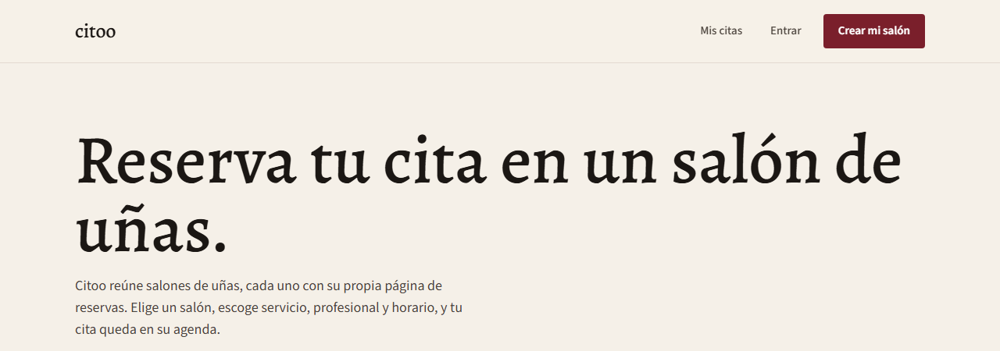
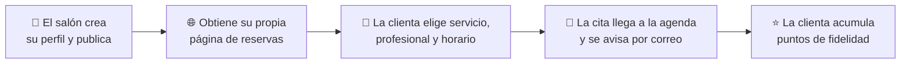

# Citoo

**Plataforma de reservas y gestión para salones de belleza.**
Cada salón con su propia página de reservas, y cada clienta con su cita y su tarjeta de puntos.

> 🔒 **Este repositorio es solo de presentación.** El código y la arquitectura de Citoo son privados y propiedad de Jeilin Castro / JC Digital. Aquí se explica qué es, qué hace y cómo está pensado.

---

## El problema

Muchos salones llevan su agenda por WhatsApp, cuadernos y capturas. Las citas se cruzan, las clientas olvidan sus horas y la dueña no sabe cuánto gana realmente por cada servicio.

## La solución

Citoo conecta las dos puntas del negocio con un mismo sistema:

<table>
<tr>
<td width="50%" valign="top">

### 💼 Para el salón
Un panel de gestión para la dueña y su equipo:

- Agenda y citas
- Inventario de insumos
- **Costeo de servicios** con margen y gastos fijos
- Ventas (punto de venta)
- Reportes
- Equipo de trabajo
- Programa de fidelidad

</td>
<td width="50%" valign="top">

### 💅 Para la clienta
Una app y una página de reservas sencillas:

- Descubrir salones
- Ver servicios, precios, equipo y trabajos
- **Reservar en pocos pasos**
- Ver sus citas
- Tener su **tarjeta de puntos**

</td>
</tr>
</table>

 Página pública de Citoo

## Cómo funciona

## Lo que lo hace distinto

- **Cada salón tiene su página** de reservas, con su logo y sus colores.
- **Costeo real:** el salón calcula cuánto cuesta cada servicio según sus insumos y gastos, y fija su margen.
- **Inventario conectado a las ventas:** los insumos se descuentan solos al vender.
- **Pensado en seguridad:** un salón nunca ve los datos de otro, y cada persona solo accede a lo que le corresponde. Ver [docs/SEGURIDAD-Y-CALIDAD.md](docs/SEGURIDAD-Y-CALIDAD.md).

## Estado actual

| Parte | Estado |
|---|---|
| Sistema de reservas y páginas públicas | ✅ En línea |
| Correos y notificaciones | ✅ Funcionando |
| Panel de gestión del salón | 🛠️ En desarrollo |
| App móvil para clientas | 🛠️ En desarrollo |

## Tecnología

**React**, **React Native (Expo)**, **TypeScript** y **Cloudflare**.

## Contacto

¿Tienes un salón y quieres probarlo, o quieres hablar del proyecto?

**Jeilin Castro** · JC Digital · Panamá
📧 jeilincastro989@gmail.com · 🌐 [jcdigital.online](https://jcdigital.online) · 💼 [LinkedIn](https://www.linkedin.com/in/jeilin-castro-5a159b2b8/)

---

© Jeilin Castro / JC Digital. Todos los derechos reservados. Las imágenes y textos de este repositorio no pueden reutilizarse sin autorización.
